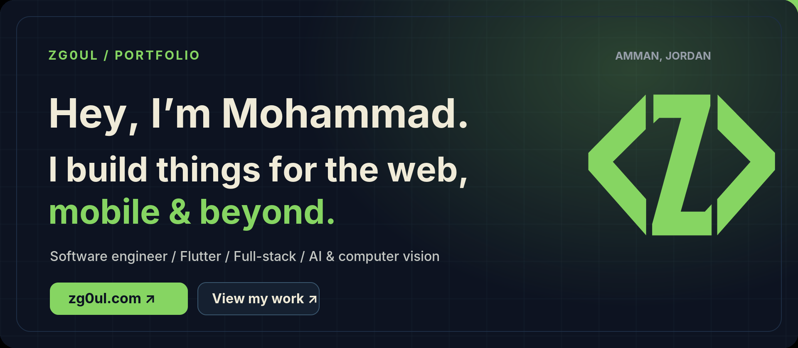
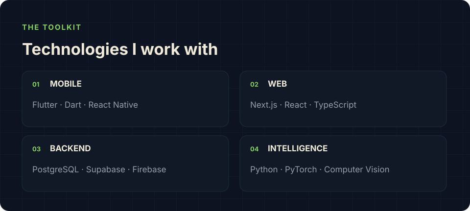
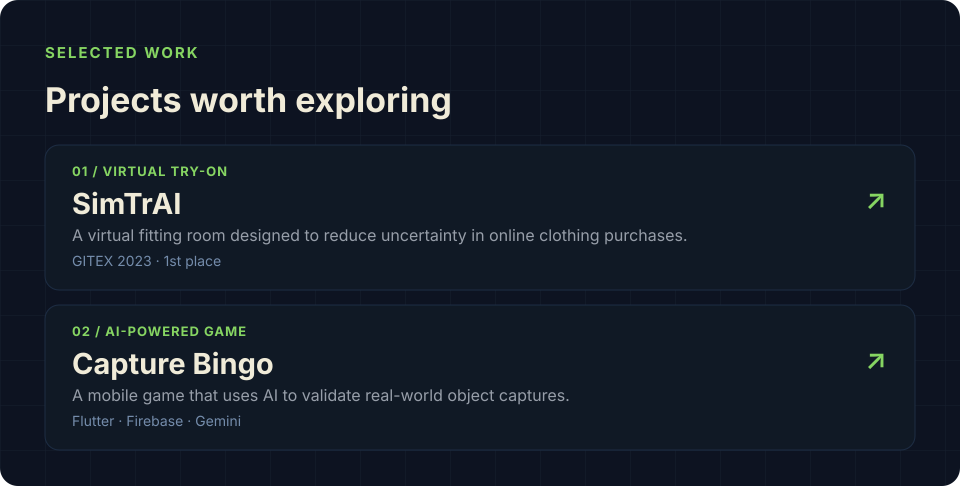
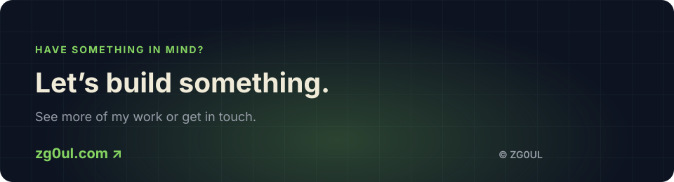

<!-- Personal GitHub profile · inspired by https://zg0ul.com -->

 

<a href="https://zg0ul.com">Portfolio</a> &nbsp;·&nbsp;
<a href="https://www.linkedin.com/in/zg0ul">LinkedIn</a> &nbsp;·&nbsp;
<a href="mailto:mohammad@zg0ul.com">Email</a> &nbsp;·&nbsp;
<a href="https://github.com/zg0ul?tab=repositories">Repositories</a>

 

I’m **Mohammad**, a software engineer with a mechatronics background. I build thoughtful mobile and web experiences, from Flutter applications to full-stack platforms, and enjoy tackling problems with AI and computer vision.

### Tools of the trade

### Selected projects

**[SimTrAI](https://zg0ul.com/projects)** — A virtual fitting-room concept tackling online clothing fit. Winner of the 2023 IEEE Region 8 entrepreneurship finals at GITEX Dubai.

**[Capture Bingo](https://zg0ul.com/projects)** — An AI-powered Flutter game where players capture real-world objects to complete a daily board.

### Beyond the code

I care about the details: thoughtful interfaces, maintainable systems, and turning ambitious ideas into real software. I started in robotics and mechatronics, but software is where I focus my work today.

